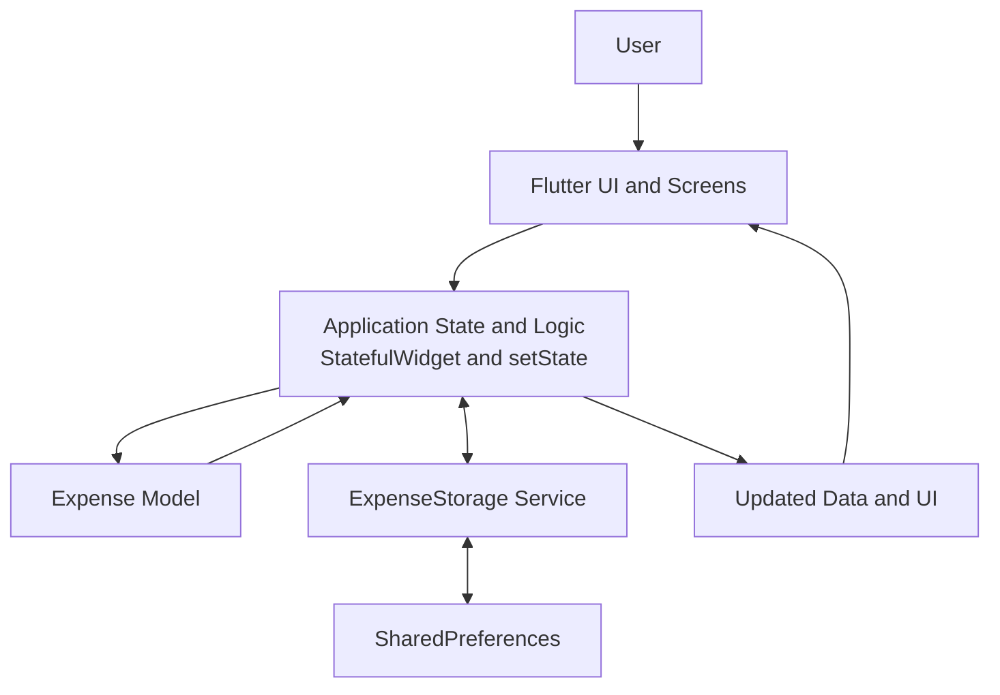

# SpendWise

**A Gamified Expense Tracking Mobile Application with Budgeting, Spending Insights, and Money Quest**

SpendWise is a Flutter-based personal finance application that helps users record expenses, monitor spending, manage budgets, and develop better financial habits through gamification. It combines everyday expense tracking with a reward system featuring experience points (XP), coins, badges, levels, themes, and daily and weekly challenges.

This project was developed for academic and mobile application development purposes.

## Table of Contents

- [Features](#features)
- [Technology Stack](#technology-stack)
- [Application Architecture](#application-architecture)
- [Project Structure](#project-structure)
- [Prerequisites](#prerequisites)
- [Installation and Setup](#installation-and-setup)
- [Running the Application](#running-the-application)
- [Testing and Code Analysis](#testing-and-code-analysis)
- [Data Storage and Privacy](#data-storage-and-privacy)
- [AI Disclosure and Human Engineering](#ai-disclosure-and-human-engineering)
- [Known Limitations](#known-limitations)
- [License](#license)

## Features

### Expense Tracking
- Add, edit, and delete expense records.
- Organize expenses by category.
- Record and review expenses by date.
- View expense information through the application's interface.

### Budget Management
- Set a monthly budget.
- Configure category-specific budgets.
- Monitor spending against budget limits.
- Receive in-app budget warnings and spending feedback.

### Spending Insights and Calendar
- Review monthly spending summaries.
- Track expenses using the calendar interface.
- Navigate between months and inspect individual dates.
- View daily expense totals and identify dates with recorded transactions.

### Money Quest Gamification
- Earn XP and coins through eligible activities.
- Progress through levels and titles.
- Complete quests and unlock badges.
- Maintain activity streaks.
- Unlock selectable themes through the in-app coin shop.

### Daily and Weekly Challenges
- Complete daily expense-tracking objectives.
- Explore different spending categories.
- Build consistency by recording expenses across different days.
- Earn XP and coins for eligible completed challenges.

### Local Persistence
- Store supported application data locally on the device.
- Retain saved expenses, budgets, and game progress across application sessions, subject to the relevant storage implementation.

## Technology Stack

| Technology | Purpose |
|---|---|
| Flutter | Cross-platform mobile application framework |
| Dart | Primary programming language |
| `shared_preferences` | Local key-value persistence |
| Flutter built-in state management | UI state updates using `StatefulWidget` and `setState()` |
| Git and GitHub | Version control and source code hosting |
| Android SDK / Android Studio | Android development and testing tools |

**State management note:** The current implementation uses Flutter's built-in state management. Riverpod and `flutter_riverpod` are not part of the documented implementation.

**Backend note:** The current application uses local persistence and does not require a custom remote backend for its core functionality.

## Application Architecture

SpendWise follows a lightweight, UI-centered architecture. The main application screen handles much of the current interface state and application logic, while the expense model represents expense data and the storage service handles persistence.

The following diagram represents the current high-level implementation, rather than a formal MVVM or Riverpod architecture.



### Architecture Components

**1. Presentation Layer**
- Displays expense records, budgets, calendar information, Money Quest, and challenge progress.
- Receives user input through Flutter widgets.
- Rebuilds relevant UI components when application state changes.

**2. Application State and Logic**
- Manages in-memory application state.
- Uses `setState()` to notify Flutter when relevant UI state changes.
- Coordinates operations such as expense updates, budget calculations, challenge completion, and reward updates.

**3. Model Layer**
- `lib/models/expense.dart` defines the expense data model used by the application.

**4. Storage Layer**
- `lib/services/expense_storage.dart` provides storage operations for supported application data.
- Uses `shared_preferences` to persist data locally.

**5. Local Data Storage**
- Stores supported application data on the device using key-value storage.
- Does not depend on a remote database for the documented core features.

## Project Structure

The principal application files include:

```text
spendwise/
├── lib/
│   ├── main.dart
│   ├── models/
│   │   └── expense.dart
│   └── services/
│       └── expense_storage.dart
├── test/
├── android/
├── ios/
├── web/
├── windows/
├── linux/
├── macos/
├── pubspec.yaml
├── pubspec.lock
├── analysis_options.yaml
└── README.md
```

The directory tree above highlights the principal files and common Flutter platform directories. Individual generated files and optional platform folders may differ depending on the local checkout.

## Prerequisites

Install the following tools before running the project:

- **Flutter SDK:** https://docs.flutter.dev/get-started/install
- **Dart SDK:** Included with Flutter.
- **Git:** https://git-scm.com/downloads
- **Visual Studio Code:** https://code.visualstudio.com/ or another compatible IDE.
- **Android Studio and Android SDK:** Required for Android emulator or device development.
- **Android device or emulator:** Required to run and test the Android application.

Verify the development environment:

```bash
flutter --version
dart --version
flutter doctor
git --version
```

Resolve any required Flutter or Android toolchain issues reported by `flutter doctor` before building the application.

## Installation and Setup

### 1. Clone the repository

```bash
git clone https://github.com/UIC-CCS-MOBILE-DEVELOPMENT-2026-2027/SpendWise-Nanual-Alconera.git
```

### 2. Open the project directory

```bash
cd SpendWise-Nanual-Alconera
```

If the repository is already cloned, open its existing local project directory instead.

### 3. Install dependencies

```bash
flutter pub get
```

This downloads the dependencies declared in `pubspec.yaml`.

### 4. Check the project configuration

```bash
flutter doctor
flutter analyze
```

Confirm that the necessary development tools are installed and review any reported code issues.

## Running the Application

Connect an Android device with USB debugging enabled or start an Android emulator.

List available devices:

```bash
flutter devices
```

Run the application in development mode:

```bash
flutter run
```

To select a particular device, use the device identifier shown by `flutter devices`:

```bash
flutter run -d DEVICE_ID
```

Replace `DEVICE_ID` with the actual identifier of the selected device.

### Build a Release APK

To create an Android release APK:

```bash
flutter build apk --release
```

The generated APK is normally located at:

```text
build/app/outputs/flutter-apk/app-release.apk
```

Transfer the APK to a compatible Android device for installation and testing. The build output may change if the project's build configuration is modified.

## Testing and Code Analysis

Run the automated Flutter tests:

```bash
flutter test
```

Analyze the Dart source code:

```bash
flutter analyze
```

Build the release APK:

```bash
flutter build apk --release
```

These commands serve different purposes:

- `flutter test` runs the automated tests included in the project.
- `flutter analyze` checks source code for reported errors, warnings, and lint issues.
- `flutter build apk --release` verifies that the application can be compiled into a release APK.

Manual testing should also cover adding, editing, and deleting expenses; budget calculations; persistence after restarting the app; calendar navigation; challenge completion; and XP and coin reward updates.

A successful automated test or build does not by itself guarantee that every feature works correctly on every physical device. Record test results only after running the corresponding checks.

## Data Storage and Privacy

SpendWise uses `shared_preferences` for local key-value persistence.

The documented core implementation does not require a remote application backend or external financial data API. Application records saved through this mechanism are stored locally on the device.

Users should understand that:
- Local application data may be lost if app data is cleared or the application is uninstalled.
- Key-value preferences are not a substitute for an encrypted financial database.
- The application should not be represented as a production banking service or as a secure financial account integration.
- Actual storage behavior depends on the implementation of each feature.

## AI Disclosure and Human Engineering

This project was developed with AI-assisted support alongside human engineering, implementation, testing, and decision-making. AI assistance is disclosed here to distinguish development support from the work required to integrate, validate, and maintain the application.

### AI Tools Used

**ChatGPT (OpenAI)** was used as an AI-assisted development tool for activities such as:
- Brainstorming and refining application features.
- Explaining Flutter and Dart concepts.
- Providing code suggestions and implementation guidance.
- Troubleshooting reported issues and interpreting errors.
- Helping prepare technical documentation and setup instructions.

AI-generated suggestions were treated as development assistance, not as proof that code was correct or functional. The project was integrated and evaluated through the development workflow.

### Human Engineering and Responsibilities

Human engineering work included:
- Selecting and refining the application's purpose and feature requirements.
- Making implementation and design decisions for the application.
- Integrating and adapting code within the Flutter project.
- Running the application and investigating issues encountered during development.
- Testing application behavior on available development environments and devices.
- Running Flutter analysis, automated tests, and release builds as appropriate.
- Reviewing and refining the project based on observed behavior and testing results.

The developer remains responsible for the final source code, application behavior, technical decisions, testing, and submitted deliverables.

### Transparency and Limitations

AI assistance does not replace software engineering judgment, independent verification, or testing. AI-generated code or explanations can contain errors and must be reviewed before being relied upon.

This disclosure describes the AI-assisted workflow used for the project; it does not claim that every line of code was independently authored without assistance or that AI tools directly executed every implementation and testing task.

Any additional AI tools, services, or contributors should be listed if they were actually used. The disclosure should be updated to reflect the final development process submitted for academic evaluation.

## Known Limitations

- Application data is primarily stored locally rather than synchronized through a remote account.
- The core implementation does not provide cloud backup or multi-device synchronization.
- The application does not directly connect to bank accounts or financial institutions.
- Data retention depends on local application storage and device behavior.
- The current state-management implementation uses Flutter's built-in mechanisms rather than Riverpod.
- Production readiness, security guarantees, and comprehensive device compatibility have not been established solely by development builds or automated tests.

## License

No license has been specified in this repository documentation. Unless a license is added, users should not assume that the source code is available for unrestricted reuse or redistribution.
